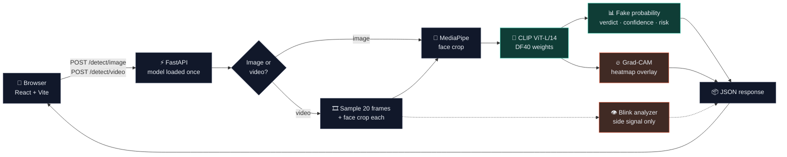
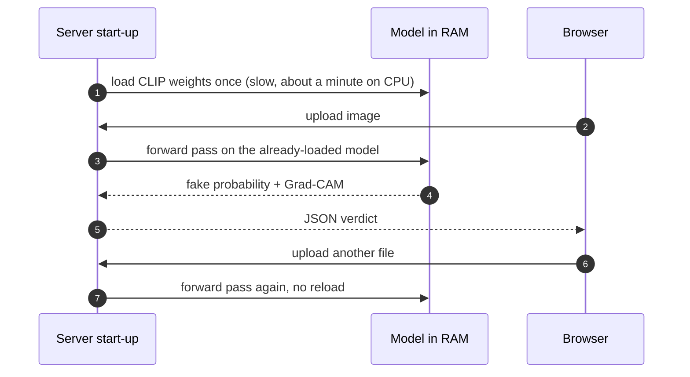

<div align="center">



<br/>


<br/><br/>

[](https://www.python.org/)
[](https://pytorch.org/)
[](https://fastapi.tiangolo.com/)
[](https://react.dev/)
[](https://vitejs.dev/)
[](#-credits--licences)

[](#-how-the-detector-works)
[](https://github.com/YZY-stack/DF40)
[](#-how-the-detector-works)
[](#-deployment)

**Built by [@YOUR_GITHUB_USERNAME](https://github.com/shubhmohan)**

</div>

---

## 📚 Table of Contents

- [The Problem](#-the-problem)
- [What It Does](#-what-it-does)
- [Architecture](#-architecture)
- [How the Detector Works](#-how-the-detector-works)
- [Tech Stack](#-tech-stack)
- [Project Structure](#-project-structure)
- [Setup](#-setup)
- [API Reference](#-api-reference)
- [Evaluation (honest numbers)](#-evaluation-honest-numbers)
- [Deployment](#-deployment)
- [Design Decisions](#-design-decisions)
- [Known Limitations & Roadmap](#-known-limitations--roadmap)
- [Credits & Licences](#-credits--licences)

---

## 🔥 The Problem

Synthetic faces are now cheap to make and hard to spot by eye. Most detection tools return a bare
verdict ("87% fake") and nothing else, which leaves two problems:

- 🎭 **No evidence.** A score with no explanation is hard to trust or to challenge.
- 🧩 **No honesty about limits.** Detectors that look great on their own benchmark often fall apart on fakes they have never seen.

**DeepShield gives a verdict *and* shows which parts of the face drove it, and it reports its own accuracy on unseen data instead of hiding it.**

---

## ⚡ What It Does

| 1️⃣ | **Accepts** an image (JPG, PNG, WebP, up to 20 MB) or a video (MP4, MOV, AVI, MKV) from a web UI |
| --- | --- |
| 2️⃣ | **Finds the face** with MediaPipe and crops it, the same way for images and for sampled video frames |
| 3️⃣ | **Scores it** with a CLIP ViT-L/14 deepfake detector using the pretrained DF40 weights |
| 4️⃣ | **Explains it** with a Grad-CAM heatmap showing which regions pushed the score toward "fake" |
| 5️⃣ | **Aggregates video**: 20 sampled frames are averaged into one verdict, and the most suspicious frame gets the heatmap |
| 6️⃣ | **Adds a side signal** for video: an eye-blink analysis (shown next to the verdict, deliberately *not* mixed into the score) |

<!--
  DEMO: record a short screen capture of an upload -> verdict -> heatmap, save it as docs/demo.gif,
  then uncomment the next two lines.

<div align="center"></div>
-->

---

## 🏗️ Architecture

<div align="center">

</div>

<br/>



<details>
<summary><b>Request lifecycle: why the model is not reloaded per upload 👇</b></summary>



The loading cost is paid once per server process. Anything that restarts the process (a host that
sleeps when idle, a serverless function) pays it again, which is why hosting choice matters. See
[Deployment](#-deployment).

</details>

---

## 🧠 How the Detector Works

<details open>
<summary><b>The model</b></summary>

- **Backbone:** the vision tower of OpenAI's CLIP **ViT-L/14** (24 transformer layers, 224 × 224 input, 14-pixel patches).
- **Head:** one linear layer, 1024 features to 2 classes. Class index 1 is "fake".
- **Weights:** the checkpoint the DF40 authors trained on all of their **face-swap** methods (`train_on_fs/clip.pth`).
- **Input:** a face crop, resized to 224 × 224 and normalised with mean 0.5 / std 0.5, exactly as in the original training config.
- **Output:** `softmax(logits)[fake]`, a probability between 0 and 1. A cut-off of 0.5 gives the verdict, and the distance from 0.5 gives a confidence value and a risk level.

</details>

<details>
<summary><b>The explanation (Grad-CAM for a Vision Transformer)</b></summary>

Standard Grad-CAM hooks a convolution layer, and a ViT has none. DeepShield uses the ViT adaptation:
take the patch-token activations of an encoder layer, weight each channel by its average gradient
toward the "fake" class, sum, and reshape the 256 patch tokens into a 16 × 16 grid that is upsampled
over the face.

One detail that matters: the hook is on the **second-to-last** encoder layer. The classifier only
reads the CLS token of the *last* layer, so the gradient with respect to that layer's patch tokens is
exactly zero and the heatmap would be blank.

</details>

<details>
<summary><b>Why the face is cropped first</b></summary>

The model was trained on face-centred crops. Feeding it a full photo (background, bodies, text) is a
distribution shift that quietly hurts accuracy. Images and video frames therefore go through the same
MediaPipe crop (with a 35% margin). If no face is found, the full image is used and the response says
`face_detected: false`.

</details>

---

## 🧰 Tech Stack

| Layer | Tools |
| --- | --- |
| 🐍 **Language** | Python 3.12, JavaScript (ES modules) |
| 🧠 **ML** | PyTorch, Hugging Face Transformers (CLIP vision tower), timm (optional EfficientNet branch) |
| 👁️ **Computer vision** | MediaPipe (face detection and eye landmarks), OpenCV, Pillow, NumPy |
| 🔥 **Explainability** | Grad-CAM adapted for Vision Transformers |
| ⚙️ **Backend** | FastAPI, Uvicorn, Pydantic schemas, `python-multipart` uploads |
| 🎨 **Frontend** | React 18, Vite 5, hand-written CSS with design tokens (Space Grotesk, IBM Plex Mono, Inter) |
| 📦 **Packaging** | Docker (multi-stage: builds the UI, then serves it from FastAPI) |
| 🧪 **Pretrained weights** | DF40 benchmark checkpoints (CC BY-NC 4.0) |

---

## 📁 Project Structure

```
Deep_Shield/
├── api/
│   ├── main.py               # FastAPI app: loads models once, /detect/image, /detect/video, serves the UI
│   ├── schemas.py            # Pydantic response models
│   └── utils.py              # numpy heatmap -> base64 PNG
├── detectors/
│   ├── image_detector.py     # orchestrator: crop -> model -> verdict -> Grad-CAM
│   ├── video_detector.py     # frame sampling, per-frame scoring, aggregation
│   ├── vit_gradcam.py        # Grad-CAM for the CLIP ViT
│   ├── explainer.py          # Grad-CAM for the CNN branch + overlay helper
│   └── blink_analyzer.py     # eye-aspect-ratio blink heuristic (side signal)
├── models/
│   ├── df40_model.py         # CLIP ViT-L/14 + DF40 weights loader
│   ├── vit_model.py          # optional ViT-B/16 branch
│   ├── efficientnet_model.py # optional EfficientNet-B4 branch
│   ├── ensemble.py           # weighted fusion + risk levels
│   └── train_*.py            # training scripts for the optional branches
├── preprocessors/
│   ├── image_prep.py         # validation + tensors
│   └── video_prep.py         # frame extraction + MediaPipe face crop
├── deepshield-frontend/      # React + Vite app
├── tests/                    # evaluation and validation scripts
├── scripts/download_weights.py
├── checkpoints/              # put clip.pth here (git-ignored)
├── assets/                   # animated README graphics
├── Dockerfile
└── requirements.txt
```

---

## 🛠️ Setup

<details open>
<summary><b>Run it locally (Windows PowerShell shown; macOS/Linux are the same apart from venv activation) 👇</b></summary>

**Prerequisites:** Python 3.12, Node.js 18+, and about 5 GB of free disk space.

```powershell
git clone https://github.com/shubhmohan/Deep_Shield.git
cd Deep_Shield

python -m venv venv
venv\Scripts\activate
pip install -r requirements.txt
```

**1. Get the weights.** The checkpoint is about 1.2 GB and is not stored in this repo. Download
`clip.pth` as described in [`checkpoints/README.md`](checkpoints/README.md) and save it as:

```
checkpoints/df40/clip.pth
```

**2. Start the backend** (from the project root). Wait for `DeepShield API ready. mode=df40_clip`:

```powershell
python -m uvicorn api.main:app --host 127.0.0.1 --port 8000
```

**3. Start the frontend** in a second terminal:

```powershell
cd deepshield-frontend
copy .env.example .env     # points the UI at http://127.0.0.1:8000
npm install
npm run dev
```

Open http://localhost:5173 and drop in an image.

**Evaluate on your own images:**

```powershell
python tests/test_df40.py --real_dir sample_data/real --fake_dir sample_data/fake
```

</details>

<details>
<summary><b>Single-server mode (one URL for UI + API)</b></summary>

```powershell
cd deepshield-frontend
npm install
npm run build              # creates deepshield-frontend/dist
cd ..
python -m uvicorn api.main:app --host 127.0.0.1 --port 8000
```

When `dist/` exists, FastAPI serves the UI at http://127.0.0.1:8000 and the API on the same origin.

</details>

---

## 🔌 API Reference

Interactive docs are served at `/docs` while the server runs.

| Method | Path | Purpose |
| --- | --- | --- |
| `GET` | `/health` | Liveness check, loaded models and active mode |
| `POST` | `/detect/image` | Multipart upload (`file`), returns verdict + heatmap |
| `POST` | `/detect/video` | Multipart upload (`file`), returns per-frame stats + heatmap |

<details>
<summary><b>Example image response (shape only; values are illustrative) 👇</b></summary>

```json
{
  "verdict": "FAKE",
  "confidence": 61.2,
  "fake_probability": 0.806,
  "risk_level": "HIGH",
  "model_used": "df40_clip",
  "model_breakdown": { "df40_clip_score": 0.806 },
  "heatmap_overlay": "data:image/png;base64,iVBORw0KGgo...",
  "face_detected": true,
  "processing_time_sec": 2.1
}
```

Errors return `{"detail": "..."}` with status `400` (bad file) or `500` (analysis failed).

</details>

<details>
<summary><b>Environment variables</b></summary>

| Variable | Default | Purpose |
| --- | --- | --- |
| `DF40_CLIP_CHECKPOINT` | `checkpoints/df40/clip.pth` | Path to the weights file |
| `DEEPSHIELD_MODEL` | `auto` | `df40_clip`, `ensemble`, or `auto` (DF40 if the file exists) |
| `DEEPSHIELD_THRESHOLD` | `0.5` | Fake-probability cut-off |
| `DEEPSHIELD_VIDEO_FRAMES` | `20` | Frames sampled per video (lower it on slow machines) |
| `ALLOWED_ORIGINS` | `*` | Comma-separated frontend origins allowed by CORS |

</details>

---

## 📊 Evaluation (honest numbers)

A first check of the integrated pipeline on a small hand-collected sample:

| Metric | Result |
| --- | --- |
| Images | 50 real + 50 fake |
| Accuracy at the 0.5 cut-off | **69%** |
| ROC AUC | **0.81** |
| Real images classified correctly | 45 / 50 (90%) |
| Fake images classified correctly | 24 / 50 (48%) |

<!-- TODO: name the dataset(s) and the fake types in this sample, then re-run on a documented test set. -->

**How to read this.** The detector rarely raises false alarms but misses about half of these fakes,
and the fake scores split into a confident group and a missed group. That fits what the weights are:
they were trained on **face-swap** methods, so other kinds of fake (GAN or diffusion faces,
re-compressed JPEGs) are expected to score lower. This is a small, unbalanced-by-type sample and not
a benchmark, and the numbers will move with a better-controlled test set.

> Reproduce with `python tests/test_df40.py`. AUC is the figure to trust; if AUC is decent but accuracy
> is low, the cut-off needs calibrating on a held-out set (never on the test set itself).

---

## 🚀 Deployment

The server loads the model **once at start-up** and reuses it, so the best host is one that keeps the
process running. The model needs roughly 4 GB of RAM or more (an estimate; measure on your machine).

| Option | Cost | Model stays loaded? | Notes |
| --- | --- | --- | --- |
| **Your own machine + a free tunnel** | free | yes, while the machine is on | Best for demos. Run single-server mode, then `cloudflared tunnel --url http://localhost:8000` for a public link. |
| **Docker on an always-on host** | paid | yes | Any VM or container host with enough RAM. Use the included `Dockerfile`. |
| Hosts that sleep when idle | varies | no, reloads after waking | Fine for occasional use, but each wake-up repeats the ~1 minute load. |

<details>
<summary><b>Docker 👇</b></summary>

```bash
docker build -t deepshield .
docker run -p 7860:7860 \
  -e DF40_WEIGHTS_URL="https://example.com/clip.pth" \
  deepshield
```

`scripts/download_weights.py` fetches the checkpoint at start-up from `DF40_WEIGHTS_URL`, or from a
Hugging Face repo via `DF40_WEIGHTS_REPO` (plus `HF_TOKEN` if private). Set
`DEEPSHIELD_VIDEO_FRAMES=8` on CPU-only hosts so video requests finish sooner.

</details>

---

## 🧭 Design Decisions

- **One model load per process**, shared between the image and video detectors, with a lock so only one analysis runs at a time (the Grad-CAM hooks keep per-call state on the model).
- **Face-first input** for both images and video, matching how the model was trained.
- **Blink analysis is shown, not scored.** It is a heuristic with no labelled data behind it, so it sits beside the verdict instead of silently changing it.
- **Evidence over confidence.** Every verdict comes with a heatmap, and the README reports weak spots.
- **Files are not kept.** Images are processed in memory; a video is written to a temp file and deleted right after analysis.

---

## 🔭 Known Limitations & Roadmap

**Limitations**

- Strongest on the kind of fake it was trained on (face swaps). Other generators score lower.
- Heavily compressed or re-saved images lose the fine artifacts detectors rely on.
- Single-face assumption; faces that are small, turned away or occluded may not be found.
- CPU inference takes seconds per image, and video takes much longer.
- The 0.5 cut-off is not calibrated on held-out data.
- A detector's output is evidence, not forensic proof.

**Roadmap**

- [ ] Evaluate on a documented, unseen test set and publish a per-fake-type breakdown
- [ ] Calibrate the cut-off on a validation split
- [ ] Fine-tune on a mix of fake types (face swap, reenactment, fully synthetic)
- [ ] Ensemble with a second architecture and compare against the single model
- [ ] GPU Docker image, request rate limiting, upload queue

---

## 🙏 Credits & Licences

- **DF40** — Yan et al., *DF40: Toward Next-Generation Deepfake Detection* (NeurIPS 2024, Datasets and Benchmarks). Pretrained weights and benchmark: [github.com/YZY-stack/DF40](https://github.com/YZY-stack/DF40) · [arXiv:2406.13495](https://arxiv.org/abs/2406.13495). Released under **CC BY-NC 4.0**: non-commercial use, attribution required. The weights are **not** redistributed in this repository. Please see the citation section of the DF40 README if you use them.
- **DeepfakeBench** — the codebase DF40 builds on: [github.com/SCLBD/DeepfakeBench](https://github.com/SCLBD/DeepfakeBench)
- **CLIP** — Radford et al., OpenAI: [github.com/openai/CLIP](https://github.com/openai/CLIP)
- **Grad-CAM** — Selvaraju et al.: [arXiv:1610.02391](https://arxiv.org/abs/1610.02391)
- **MediaPipe**, **PyTorch**, **Hugging Face Transformers**, **FastAPI**, **React**, **Vite**.

The code in this repository is MIT licensed (see [`LICENSE`](LICENSE)). Because the pretrained weights are
non-commercial, so is any deployment that uses them.

---

<div align="center">

**Built by [@shubhmohan](https://github.com/shubhmohan)**

[](https://github.com/shubhmohan)

⭐ **If this project helped you, consider giving it a star!** ⭐

</div>
